# Landing page, round 1: three variants

The owner asked for a new landing page for goodrep.fitness and said "go crazy". This round prototypes three
deliberately different pages, runs them past one critic for three rounds and recommends one. **The owner picks.**
Nothing on the live site changes here: `index.html`, `privacy/` and `support/` are untouched, and a follow-up moves
the chosen variant to the root.

**Recommendation: C · Gym clock** (critic 9/10). A · Six sets (8.5) is the runner-up and worth keeping as launch-poster
copy; B · The session (7.5) is the safe product tour and is the one to retire.

| | A · Six sets | B · The session | C · Gym clock |
|---|---|---|---|
| Phone | 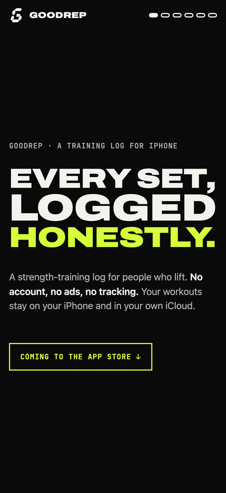 | 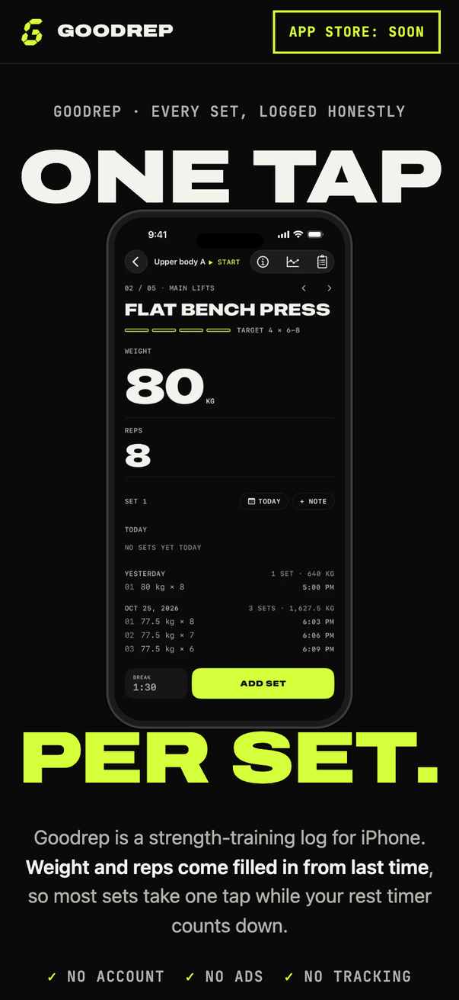 | 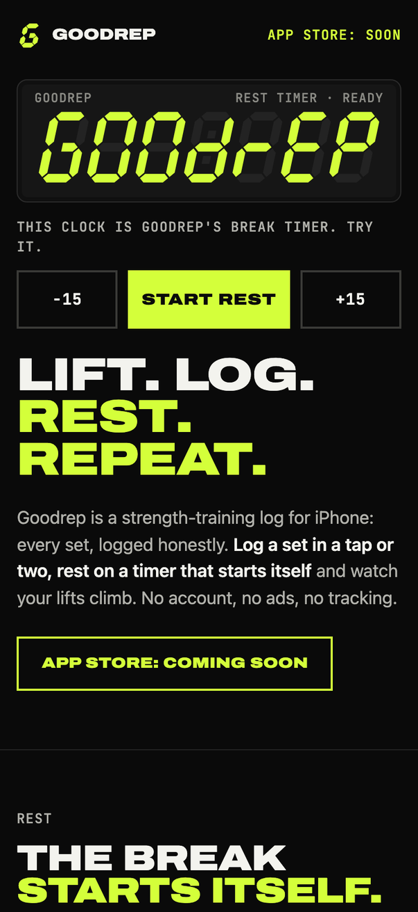 |
| Desktop |  | 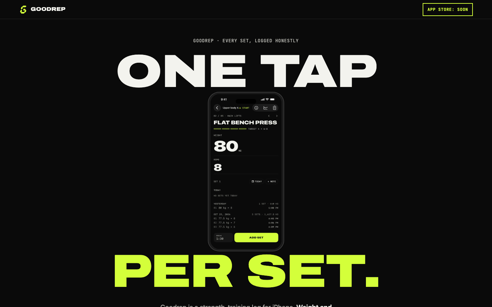 | 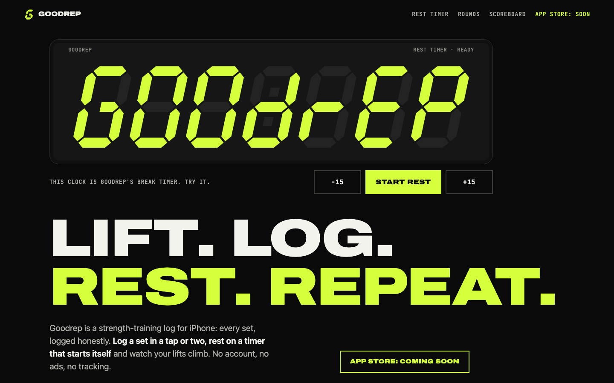 |

## How to look at them

```sh
cd goodrep-site && python3 -m http.server 8000
# http://localhost:8000/prototypes/A/  …/B/  …/C/
```

Each page is one self-contained `index.html` (HTML, CSS and a little vanilla JS), plus shared images in `assets/`.
Screenshots are regenerated with `node tools/shots.mjs <outDir> A B C` (headless Chrome over the DevTools protocol;
phone 402×874 @2x, desktop 1440×900, mid-scroll frames and true full pages). C's seven-segment displays are static
SVG generated by `python3 tools/segments.py`.

Research behind the three ideas: [`docs/research/landing-pages.md`](../research/landing-pages.md) (37 references
from Mobbin, 23 of them fitness).

## Shared ground

- **Volt, on the web.** Gym-floor black `#0A0A0A`, one accent chartreuse `#D4FF3A` with ink `#0A0A0A` on it, the
  Volt greys and surfaces (`docs/design/volt.md` §2.1 in the app repo). No gradients, glows or second accent.
  Text pairs come from volt.md's contrast table (≥ 4.5:1; the dimmest text is `#8A8A84` on `#161616`, 5.21:1).
- **Type.** SF Pro Expanded Black is not licensed for the web, so the display face is **Archivo** at width 125,
  weight 900 (Google Fonts, variable), with **JetBrains Mono** for the mono labels and `system-ui` for reading.
  Together they are two woff2 files, about 66 KB.
- **The mark.** The H · Clock icon is redrawn as an inline SVG from its 1024 px render (six polygons), so the header,
  favicon and badges need no image. The 180 px touch icon and a new 1200×630 `assets/brand/og.png` are rendered files.
- **Real screens only.** The six dark App Store screenshots, as WebP at 600 and 1000 px (20–67 KB each), and one crop
  of the session screen's set list (A).
- **Facts only.** Every claim is in the store description (`docs/store/metadata.md`) or SPEC §4. The price is not
  stated anywhere, the same as in the store copy: the App Store shows it.
- **Launch state.** The app is not live. Every variant has one "Coming to the App Store" state. Hero links jump to it
  (`href="#appstore"`), the state itself is not a link, and a `TODO` comment marks where the App Store URL goes.
- **Footer.** Privacy policy (`/privacy`), Support (`/support`), `support@goodrep.fitness`, © 2026 Mukhammadjon
  Ibragimov (the store copyright line).
- **Checks.** Lighthouse (mobile): accessibility 100, best practices 100, SEO 100 on all three after round 3's
  fixes. Measured in Chrome at 412×823 with Slow 4G and a 4× CPU slowdown: first contentful paint about 670 ms,
  load event 740–840 ms, layout shift 0.037 (A), 0.018 (B), 0 (C). Lighthouse's own "agentic browsing" check
  reported a layout shift of 0.58 for B that the in-page measurement does not reproduce; B's pinned stage is sized in
  viewport units and Lighthouse resizes the viewport, which is the likely cause. All motion stops under
  `prefers-reduced-motion`; nothing is hidden when JavaScript fails.

## A · Six sets

> A type-only manifesto in chartreuse and gym-floor black, paced like a workout: six statements, one per screen,
> each line stretched to the full width; the app itself appears only at the end.

**Structure.** "EVERY SET, LOGGED HONESTLY." → "ONE TAP. NEXT SET." (chartreuse) → "REST. IT STARTS ITSELF." →
"BEAT LAST TIME." with a real crop of the app's set list → "NOBODY IS WATCHING." (chartreuse, privacy) →
"PAY ONCE. OR NEVER." (Pro) → the phone with a spec sheet of leader rows, the launch state, a full-width wordmark.
The header's six pills fill like the app's target pills as you scroll ("SET 3/6"), and its ink flips to black over
the chartreuse blocks.

**Why it is bold.** Nike-After-Dark confidence in the brand's own colours; no product shot for six screens. Each
line is fitted to the full width by a few lines of script, so every screen is a poster.

| Phone, mid-scroll | Desktop, mid-scroll | Whole page (phone) | Whole page (desktop) |
|---|---|---|---|
| 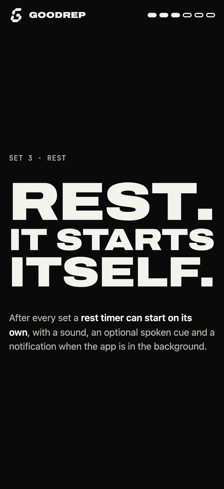 | 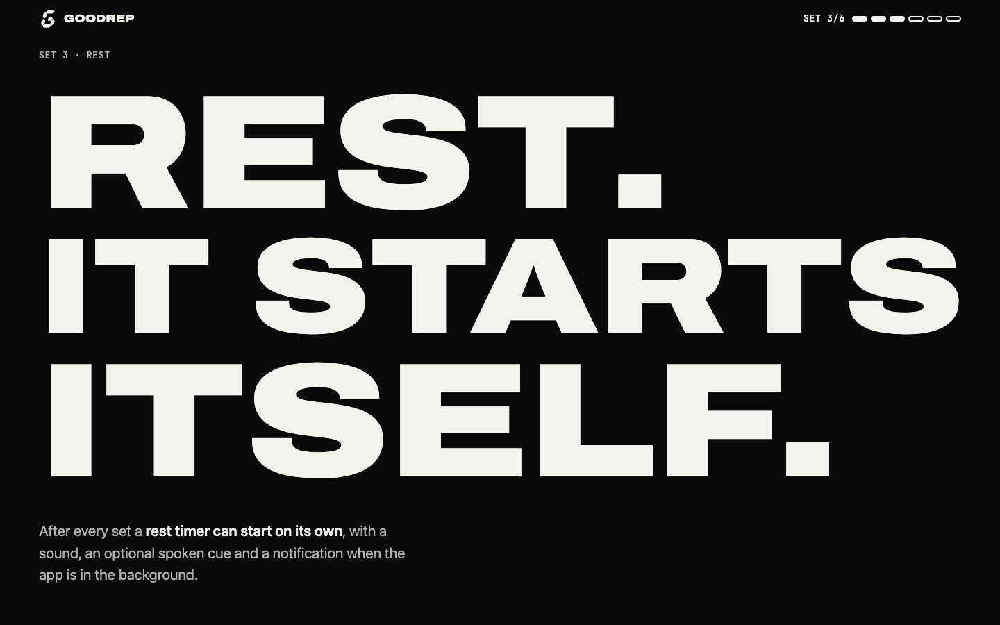 | [full page](shots/final-A-phone-full.jpg) | [full page](shots/final-A-desktop-full.jpg) |

## B · The session

> Phone-first: one iPhone stays pinned while the story scrolls past it; its screen moves through five real screens in
> the order you use them (pick, plan, log, finish, look back) and ends on the G.

**Structure.** "ONE TAP / PER SET." brackets the real session screen (80 kg × 8, Add set). "Six screens, start to
finish." Then the pinned phone with a progress track and six chapters, each led by a big numeral quoted from its
screen (400+, 3×8–10, 80 kg × 8, 2,168 kg, 6 days in Oct, 0 accounts). Then Free vs Goodrep Pro as two columns,
the launch state and the footer. Chapters not on screen dim their numeral and heading.

**Why it is bold.** It isn't, structurally: pinned-phone scrollytelling is a known product-page pattern, and the
critic said so in every round. Its strength is that it shows the most product, honestly.

| Phone, mid-scroll | Desktop, mid-scroll | Whole page (phone) | Whole page (desktop) |
|---|---|---|---|
| 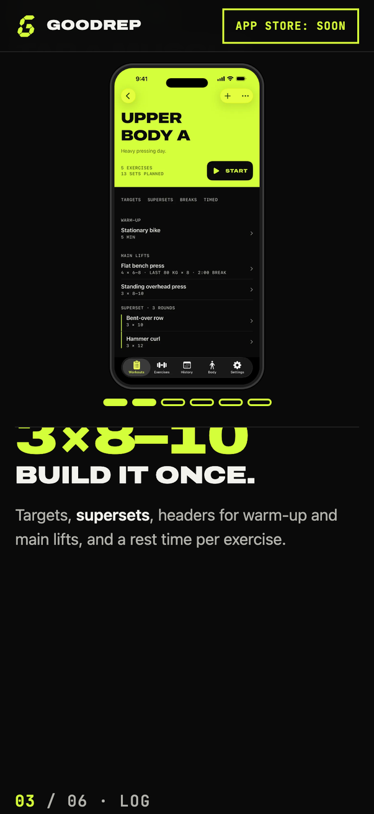 | 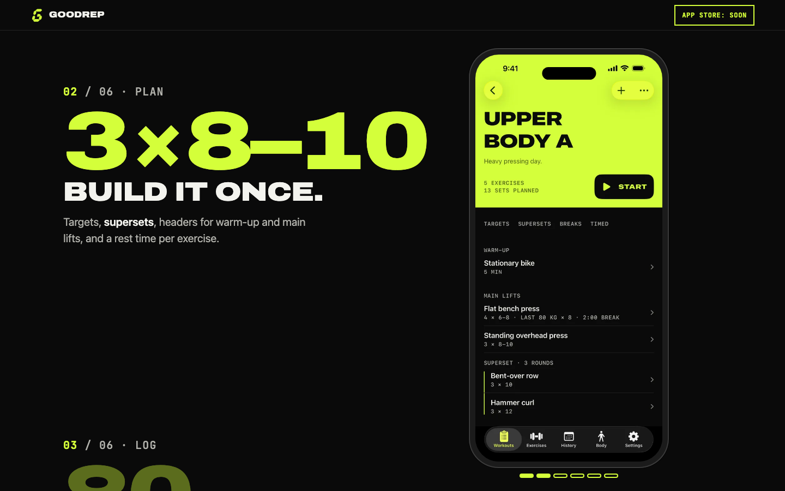 | [full page](shots/final-B-phone-full.jpg) | [full page](shots/final-B-desktop-full.jpg) |

## C · Gym clock

> The page is the LED interval clock on the gym wall, built from the app icon's slanted seven-segment G: it spells
> GOODREP, runs a real rest timer you can start, and keeps score of what the app leaves out.

**Structure.** The hero is a clock housing whose seven slanted cells read **GOODREP**, drawn with the icon's
geometry, including its half crossbar. Under it are −15 / **Start rest** / +15. Start turns the display into
**01 : 30** and counts down there (deadline-based, like the app). At zero it flashes **GO**, prints the spoken cue,
"Break over. Next: Standing overhead press." (SPEC E5.1), in a live region, then spells GOODREP again. Below:
"LIFT. LOG. REST. REPEAT.", the rest facts as leader rows, four "rounds" with real screens and seven-segment numerals,
and a **scoreboard** that counts in segments: accounts 0, ads 0, trackers 0, subscriptions 0, payments for Pro 1,
exercises 400+. Then the launch state and a seven-segment GOODREP footer.

**Why it is bold.** The headline, the icon and the interaction are one object. No fitness site in the study does
anything like it, and it demonstrates the feature the store copy leads with instead of describing it.

| Phone, mid-scroll | Desktop, mid-scroll | Whole page (phone) | Whole page (desktop) |
|---|---|---|---|
| 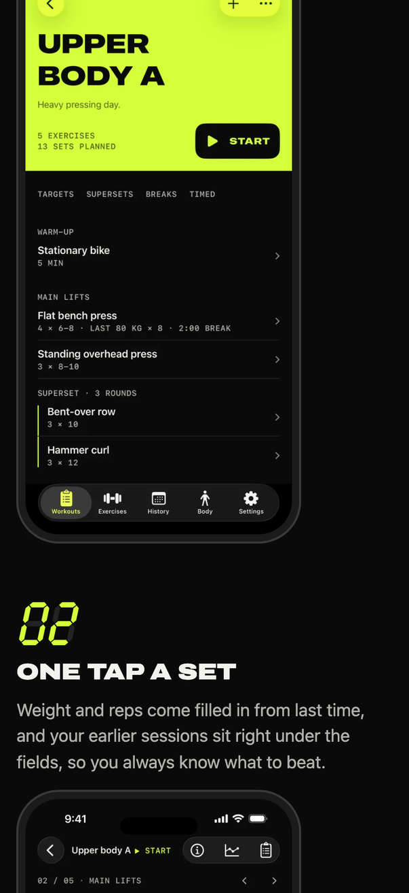 | 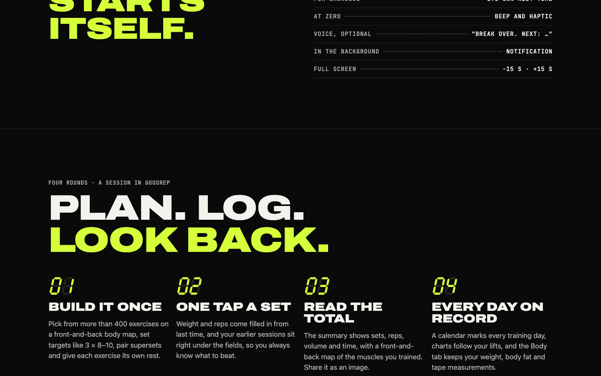 | [full page](shots/final-C-phone-full.jpg) | [full page](shots/final-C-desktop-full.jpg) |

## Critic rounds

One critic (a subagent on the Fable model, kept across rounds) saw the phone, desktop, mid-scroll and full-page
screenshots of each round plus the source. Its notes, condensed, and what changed:

| Round | A | B | C |
|---|---|---|---|
| 1 | 7.5 | 6.5 | 8 |
| 2 | 8 | 7 | 8.5 |
| 3 (final) | **8.5** | **7.5** | **9** |

Round 1 first screens, for comparison with the final ones above:

| A | B | C |
|---|---|---|
| 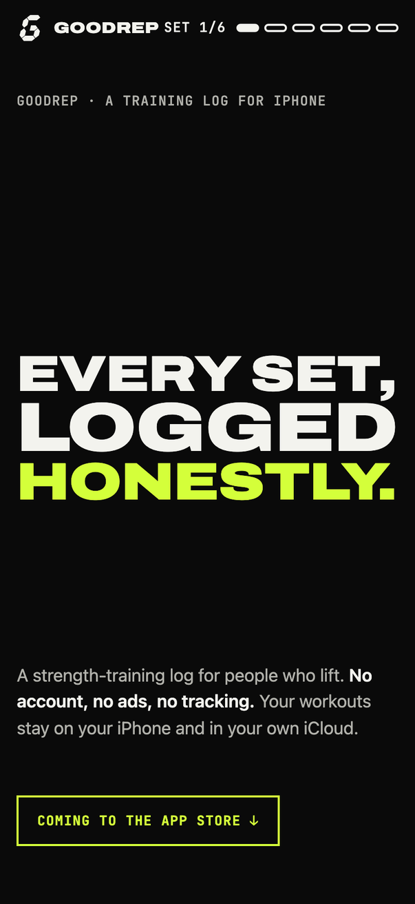 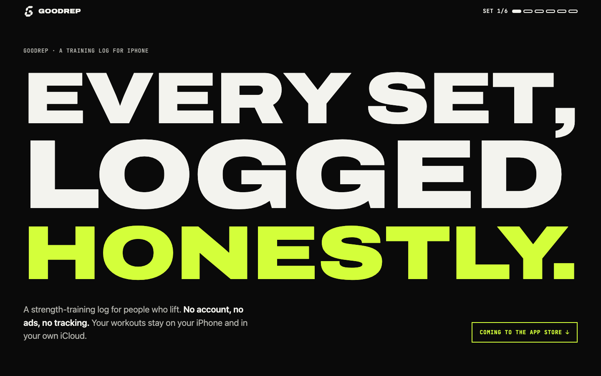 | 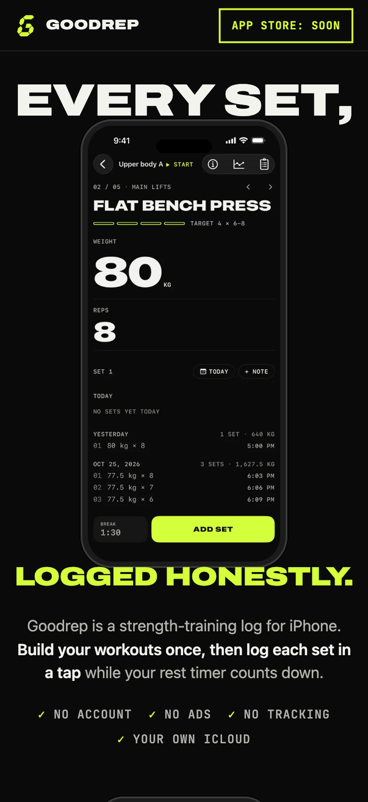 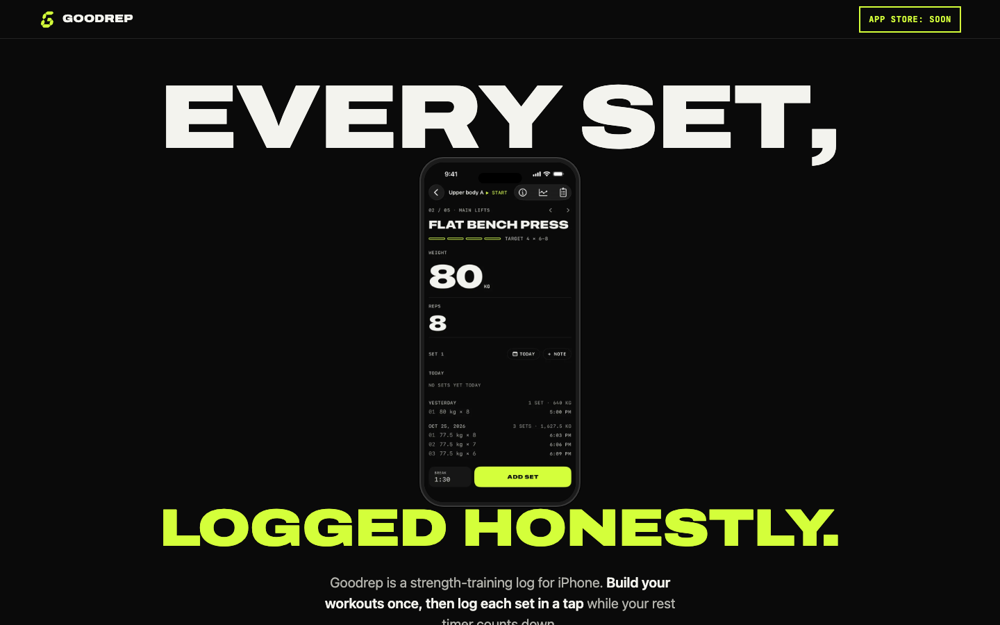 | 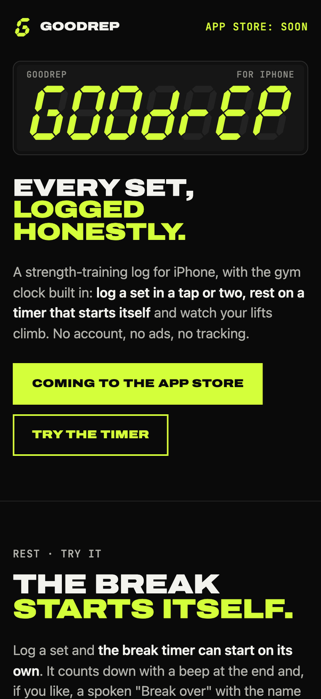 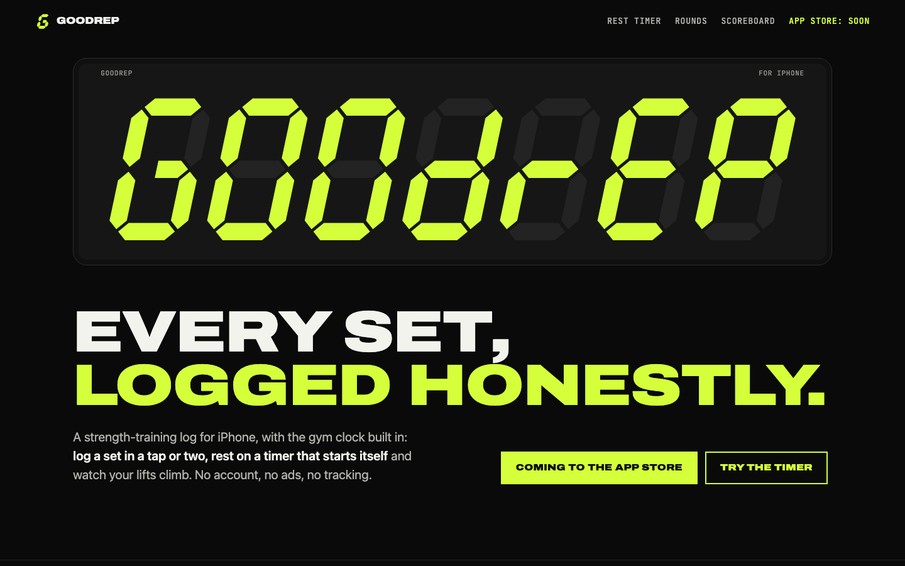 |

### Round 1

- **A, 7.5.** "The bravest and most on-brief idea, executed cleanly." The header ink flipped on the wrong trigger
  (black on black between sections), and there was no evidence of the app until screen 7. The final badge linked to
  itself. A JS error would have blanked the page.
- **B, 6.5.** "Competent and the most informative, but pinned phone + scrolling chapters is the standard product-page
  template." On phones the reading band was cramped, two phones appeared back to back, the header let colour bleed
  through, and the scroll ran long on desktop.
- **C, 8.** "The only variant whose idea comes from the brand's own mark, with a real interactive proof of the
  headline feature." Three of four rounds sat off-screen in a rail on phones, the hero h1 was timid, the filled CTA
  led nowhere, and headings orphaned.
- **Shared.** Dead `#appstore` self-links; the og:image was a 512 px icon; all three used the same headline.
- **Fact check.** The critic flagged headers, custom-exercise photos, switching units from the weight field, tape
  measurements, the free top-weight chart and the landscape chart as unverified. All of them are in the store
  description, so they stayed. It accepted that in round 2.

**Changed for round 2.** Each variant got its own headline (A "Every set, logged honestly.", B "One tap per set.",
C "Lift. Log. Rest. Repeat."). The launch state became a non-link. A new 1200×630 og:image. A: header ink driven by a
2 px band under the header, a real crop of the set list in set 4, Family Sharing added. B: opaque header, a 46svh
stage on phones, shorter chapters, a big quoted numeral per chapter. C: rounds stacked on phones, the timer became the
primary CTA, balanced headings, an on-brand hover.

### Round 2

- **A, 8.** All round-1 findings fixed. Left: a load flicker from the late `.js` class, a band computed once, 11 px
  captions, `role="status"` on static text.
- **B, 7.** The bracket and numerals were a real improvement. But the headline ("one tap") now sat around the summary
  screen, the phone screen lagged the text on phones, two chapters showed at once on desktop, and two phones were
  still back to back.
- **C, 8.5.** "The mobile first screen is the best of the three." The CTA had fallen below the desktop fold and the
  timer heading orphaned. Its route to 9.5: "make the page's clock one object… the headline, the icon and the
  interaction are literally the same thing."

**Changed for round 3.** C took the 9.5 idea: the hero display is the live timer (a colon in the middle cell, GO at
zero, the spoken line printed), and the separate timer box became a facts list. A: no load flicker, the band rebuilt on
resize. B: the session screen back in the hero, a 70 % trigger band on phones, inactive chapters dimmed, an intro
between the two phones. Lighthouse fixes on all three: the frame's exact screenshot ratio, C's ±15 accessible names,
the contrast of A's footer wordmark.

### Round 3 (final)

- **A, 8.5.** "A type-only manifesto that owns the brand voice: six statements, black and chartreuse, paced like a
  workout. It is the most confident of the three and the least informative; it sells an attitude before it sells an
  app."
- **B, 7.5.** "The most complete product tour, with real screens and quoted numbers, but its pinned-phone
  scrollytelling is the one convention the brief asked us to avoid, and on phones the mechanic still fights the
  reading."
- **C, 9.** "The page is the gym clock: the app icon's seven-segment G becomes a live rest timer you can run from the
  hero, then spells the brand again. It is the only variant whose idea comes from the product itself, it shows every
  real screen, and it demonstrates the headline feature instead of describing it."
- Non-blocking nits, all fixed after the review: "Beep and haptic" was questioned, but SPEC E5.1 specifies a
  `.success` haptic, so it stays. The clock SVG's label now follows what it shows ("Break timer 01:29"). The nav link
  jumps to the clock. After ±15 with no break running, the clock returns to GOODREP after 10 s. ±15 while paused
  now adjusts the remaining time. B got a hairline under its stage so numerals don't look cut.
- **Critic's ranking:** C (ship as index.html), A (keep the voice), B (retire; reuse its Free/Pro table if needed).

## Comparison

| | A · Six sets | B · The session | C · Gym clock |
|---|---|---|---|
| One dominant idea | Type as poster, paced as sets | The pinned phone tells the story | The icon becomes the gym clock |
| Product shown | One crop mid-way, one phone at the end | Six real screens | Four real screens plus the working timer |
| Interaction | Scroll; header pills count sets | Scroll-driven screen changes | Start, pause and nudge a real rest timer |
| Distinctiveness | High (voice) | Low (known pattern) | Highest (built on the brand mark) |
| Explains the app | Least | Most | Enough, and demonstrates one feature |
| Mechanics that can go wrong | Line fitting, header band | Sticky stage, observer band on small phones | None for content; the timer is self-contained |
| Page weight (HTML, then images; 600 px WebP sizes, before gzip) | 19 KB, then 42 KB lazy | 21 KB, then 170 KB (hero and the five stage screens) | 47 KB (inline SVG), then 122 KB lazy |
| Critic, final | 8.5 | 7.5 | **9** |

## Recommendation

**Ship C · Gym clock.** It's the only variant whose idea comes from Goodrep itself. The icon, the app's rest timer and
the store subtitle become one thing a visitor can touch in the first screen. It still shows four real screens and
says plainly what the app leaves out. It has the fewest moving parts: everything except the timer is static HTML and
SVG.

Keep A's copy: "Nobody is watching." and "Pay once. Or never." are the strongest lines of the round and fit C's
scoreboard or the App Store promotional text.

**Follow-up when the owner picks** (not in this PR):
1. Move the chosen `prototypes/X/index.html` to `/index.html`; change `../../assets/` to `/assets/`; add
   `og:url` and a canonical link.
2. When the app is live, replace every `#appstore` placeholder (marked `TODO`) with the App Store URL and Apple's
   badge, and drop "not out yet".
3. Restyle `privacy/` and `support/` to match (they still use the old orange-accent template).
4. Delete the unchosen prototypes, or keep them under `prototypes/` (they are not linked from anywhere).

## Decisions made without the owner

- **Archivo (width 125) and JetBrains Mono** stand in for SF Expanded and SF Mono; both are free on Google Fonts and
  are the only external requests.
- **Dark only.** The app's primary look is dark (volt.md §1); the pages do not switch to a light theme.
- **No price on the page**, matching the store copy; "one-time" and "no subscription" carry the message.
- **Launch state is not a link.** Hero links jump to it; a link to itself (as first built) did nothing when clicked.
- **Copyright line** uses the seller's name from the store metadata.
- **Screenshots and research.** Mobbin's web library has no marketing sites for Strava, WHOOP, Oura, Peloton or
  Zwift, so their iOS welcome screens were studied instead. The `/opt/homebrew/bin/chromium` wrapper points at a
  missing app, so screenshots use the installed Google Chrome in headless mode.
